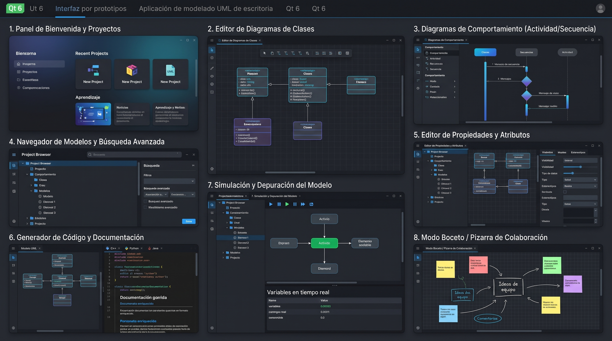

# onlyArchitect

**onlyArchitect** es una suite moderna, limpia y modular en C++20 y Qt6 para el modelado de software y diseño de arquitectura UML.



---

## 1. Características Principales

* **Modelado UML Completo**: Soporte para paquetes, clases, interfaces, notas, diagramas y conectores (generalización, realización, asociación, composición, agregación y dependencia).
* **Editor Gráfico Interactivo**: Lienzo basado en `QGraphicsScene` con arrastre fluido, waypoints ortogonales, alineación y redimensión en tiempo real.
* **Persistencia Robusta**: Motor de base de datos relacional basado en SQLite (`.qea`), transaccional y de alto rendimiento.
* **Renderizado Vectorial & Exportación**: Renderizado gráfico de diagramas mediante Cairo / SVG y exportación a formatos estructurados (PlantUML, JSON).
* **Herramientas de Productividad**: Generador de código (C++, Python, Java), navegador de modelos jerárquico, consola SQL interactiva y pizarra de notas (Whiteboard).
* **Compatibilidad de Migración**: Diálogo integrado para importar proyectos legados (`.eapx` / `.eap`) a bases de datos modernas `.qea`.

---

## 2. Compilación y Construcción

### Dependencias del Sistema:
* Compilador GCC o Clang con soporte para C++20
* CMake 3.20 o superior
* Qt6 (Widgets, Svg, SvgWidgets)
* SQLite3
* Cairo

```bash
mkdir -p build && cd build
cmake ..
cmake --build . -j$(nproc)
```

---

## 3. Ejecución

### Aplicación Gráfica (`onlyarchitect-gui`):
```bash
./build/onlyarchitect-gui
```
O especificando directamente un repositorio de modelos:
```bash
./build/onlyarchitect-gui my_model.qea
```

### Interfaz de Línea de Comandos (`onlyarchitect`):
```bash
# Ver información y estadísticas del repositorio
./build/onlyarchitect info my_model.qea

# Visualizar el árbol de paquetes y elementos
./build/onlyarchitect tree my_model.qea 2

# Renderizar diagramas a SVG y PNG
./build/onlyarchitect render my_model.qea --diagram 11 --out diagram11.svg
./build/onlyarchitect render my_model.qea --diagram 11 --out diagram11.png

# Exportar diagrama a PlantUML
./build/onlyarchitect export my_model.qea --diagram 11 --format plantuml --out diagram11.puml

# Consultas directas a la base de datos
./build/onlyarchitect query my_model.qea "SELECT Diagram_ID, Name FROM t_diagram LIMIT 5"

# Crear un nuevo repositorio en blanco
./build/onlyarchitect create nuevo_modelo.qea
```

---

## 4. Tests Automatizados

```bash
cd build
./test_onlyarchitect
./test_gui
./test_views
```
