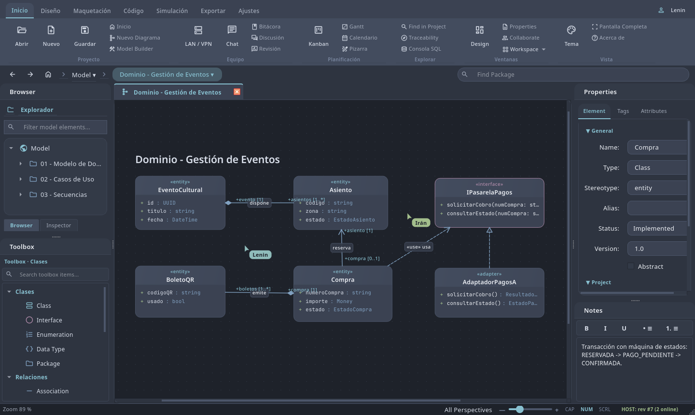
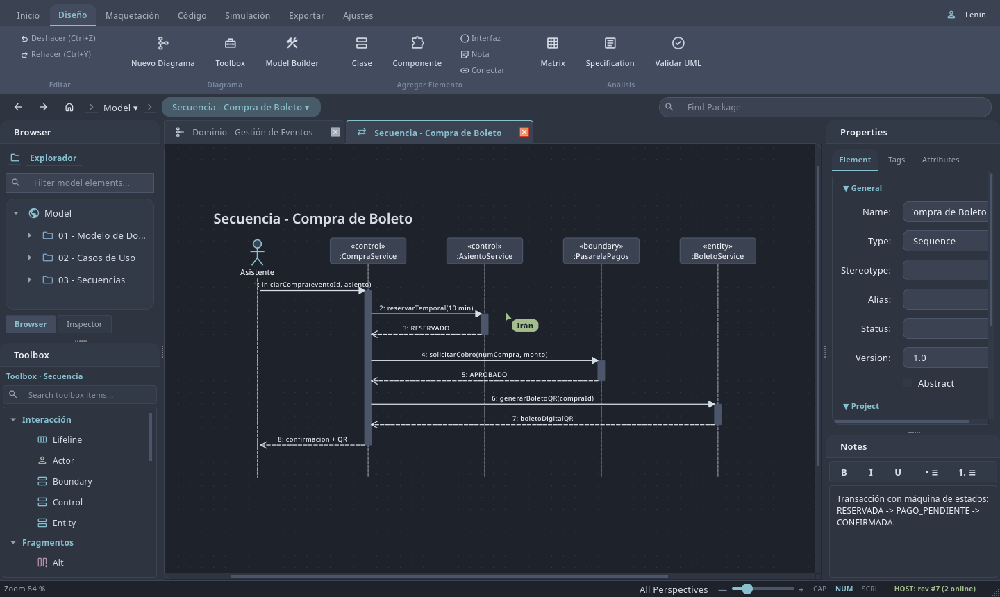
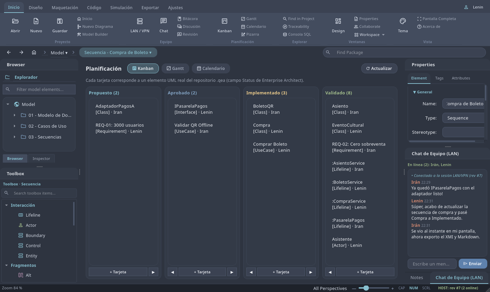
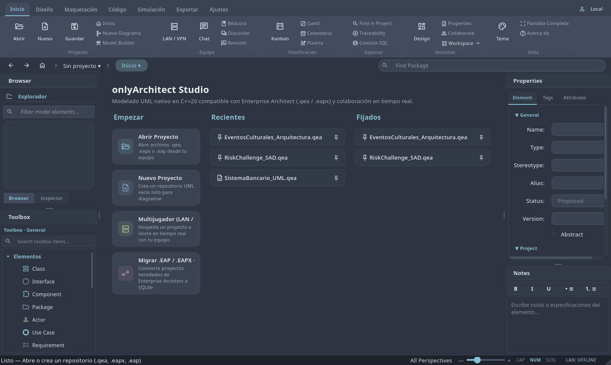

# onlyArchitect

[](https://github.com/IR1728/onlyArchitect/actions/workflows/ci.yml)
[](https://github.com/IR1728/onlyArchitect/releases)
[](LICENSE)

**onlyArchitect Studio** es una suite nativa, libre y modular en **C++20 y Qt6** para modelado **UML 2.5.1 (OMG)**, arquitectura de software y **colaboración multijugador en tiempo real sobre LAN / VPN**, con interoperabilidad para repositorios SQLite (`.qea`), migración de bases de datos Access (`.eap` / `.eapx`) e intercambio estándar **XMI 2.5.1**.



### Vistas de la Suite

| Diagramas de Secuencia UML 2.5 | Planificación Kanban + Chat LAN en Vivo |
|---|---|
|  |  |

<details>
<summary>Ver Página de Inicio (Start Page · Material Design 3 / Nord)</summary>



</details>

---

## 1. Descarga e Instalación en 1 Clic (Sin compilar ni instalar dependencias)

Haz clic en el botón de tu sistema operativo para descargar directamente la última versión desde **[Releases](https://github.com/IR1728/onlyArchitect/releases/latest)**:

<p align="center">
  <a href="https://github.com/IR1728/onlyArchitect/releases/latest/download/onlyArchitect-Setup-windows-x64.exe">
    
  </a>
  <a href="https://github.com/IR1728/onlyArchitect/releases/latest/download/onlyArchitect-macos-arm64.dmg">
    
  </a>
  <a href="https://github.com/IR1728/onlyArchitect/releases/latest/download/onlyArchitect-linux-x64.AppImage">
    
  </a>
  <a href="https://github.com/IR1728/onlyArchitect/releases/latest/download/onlyArchitect-linux-x64.deb">
    
  </a>
</p>

| Plataforma | Descarga Directa | Cómo instalarlo |
|---|---|---|
| **Windows (x64)** | [onlyArchitect-Setup-windows-x64.exe](https://github.com/IR1728/onlyArchitect/releases/latest/download/onlyArchitect-Setup-windows-x64.exe) · ([Portable .zip](https://github.com/IR1728/onlyArchitect/releases/latest/download/onlyArchitect-windows-x64-portable.zip)) | Doble clic → Siguiente → Instalar (trae todas las DLLs Qt6/Cairo/SQLite y asocia `.qea`). |
| **macOS (Apple Silicon)** | [onlyArchitect-macos-arm64.dmg](https://github.com/IR1728/onlyArchitect/releases/latest/download/onlyArchitect-macos-arm64.dmg) | Doble clic → arrastra **onlyArchitect.app** a **Aplicaciones**. Al ser software libre firmado *ad-hoc*, si macOS muestra aviso de Gatekeeper ejecuta una sola vez: `xattr -cr /Applications/onlyArchitect.app` |
| **Linux (Universal)** | [onlyArchitect-linux-x64.AppImage](https://github.com/IR1728/onlyArchitect/releases/latest/download/onlyArchitect-linux-x64.AppImage) | `chmod +x onlyArchitect-linux-x64.AppImage && ./onlyArchitect-linux-x64.AppImage` (cero dependencias). |
| **Linux (Debian / Ubuntu / Mint)** | [onlyArchitect-linux-x64.deb](https://github.com/IR1728/onlyArchitect/releases/latest/download/onlyArchitect-linux-x64.deb) | `sudo apt install ./onlyArchitect-linux-x64.deb` (agrega acceso en el menú y CLI en `/usr/bin`). |

---

## 2. Características Principales

* **Modelado UML 2.x Completo (14 tipos de diagrama):** Clases, Interfaces, Componentes, Paquetes, Despliegue, Estructura Compuesta, Objetos, Casos de Uso, Secuencia (con lifelines, barras de activación y fragmentos combinados), Actividad, Máquina de Estados, Comunicación, Tiempos e Interacción.
* **Compatibilidad nativa `.qea`, `.eap` / `.eapx` y XMI 2.5.1:**
  * Motor SQLite transaccional sobre un esquema *clean-room* mínimo de **15 tablas núcleo** interoperable con repositorios `.qea`.
  * Migración automática de repositorios legados MS Access (`.eapx` / `.eap`) a `.qea` mediante `mdbtools` opcional del sistema (`sudo apt install mdbtools` en Linux / `brew install mdbtools` en macOS).
  * Importación y exportación **XMI 2.1 / 2.5.1** con preservación de GUIDs, estereotipos y protecciones anti-XXE / XML-DoS.
* **Editor Gráfico Interactivo (Material Design 3 / Nord):**
  * Lienzo `QGraphicsScene` con zoom (10 % – 400 %), ajuste a rejilla, 8 asas de redimensión, selección por marco, arrastrar desde el explorador/toolbox y **Undo/Redo** completo por diagrama.
  * Validador semántico UML (reglas de conexión, multiplicidades y detección de ciclos de herencia).
* **Colaboración Multijugador en Tiempo Real (LAN / VPN — Tailscale, ZeroTier, red local):**
  * Servidor integrado en la GUI o binario dedicado sin interfaz (`onlyarchitect-server <proyecto.qea> --port 7777 --token <PIN>`).
  * **Cursores remotos en vivo** con nombre y color, **arrastre en vivo (~28 FPS)**, snapshots `.qea` comprimidos con zlib (`OAZ1`), recarga *in-place* sin perder zoom/cámara y **Chat de Equipo en tiempo real**.
  * **Seguridad integrada:** PIN de sala opcional (comparación en tiempo constante), límite anti-zip-bomb (128 MiB), verificación de integridad SQLite (`PRAGMA quick_check`) y respaldo automático `.bak` antes de sobrescribir.
* **Planificación y Colaboración persistida en `.qea`:**
  * Tablero **Kanban** real sobre `t_object.Status`, **Cronograma Gantt** visual, **Calendario de Hitos**, **Bitácora (Journal)**, **Discusiones** y **Revisiones**.
* **Flujos reales de Diseño UML (Dominio, CUS y Secuencia):**
  * Editor completo de conectores y mensajes (roles, multiplicidades `1..*`, estereotipos `«include»`/`«extend»`, autocompletado de operaciones de la clase destino en secuencias).
  * Plantilla estructurada de especificación para Casos de Uso y refinamiento directo **CUS → Diagrama de Secuencia** en 1 clic.
* **Simulador Real (`ea::simulation::SimulationEngine`):** Recorre nodos, decisiones, transiciones y mensajes (`SeqNo`) de cualquier diagrama del repositorio con breakpoints y tabla de variables en vivo.
* **Model Builder (`ea::editor::ModelPatternService`):** Instancia patrones UML reales (paquete + diagrama + elementos y relaciones iniciales) directamente en el repositorio.
* **Whiteboard Persistido:** Pizarra colaborativa de post-its guardada como elementos `Note` reales dentro del `.qea`.
* **Generación de Código y Documentación:**
  * Código fuente en **C++**, **Rust**, **C#**, **Python**, **Java** y **SQL DDL** (copiar o guardar a archivo).
  * Exportación a **SVG**, **PNG** (Cairo), **PlantUML**, **JSON**, **XMI** y **Documentación completa del modelo en Markdown (`.md`)**.
* **Herramientas de Análisis:** Búsqueda en proyecto, Matriz de Relaciones, Trazabilidad, Specification Manager y Consola SQL interactiva.

---

## 3. Arquitectura (Clean Architecture)

```text
onlyArchitect
├── include/ea/ & src/        # onlyarchitect_core (C++20 puro, SIN dependencia de Qt)
│   ├── core/                 # Tipos UML, colecciones, GUIDs
│   ├── model/                # Package, Element, Diagram, Connector, Attribute, Method
│   ├── repository/           # StorageEngine, SqliteStorageEngine, EapxImporter, Repository
│   ├── editor/               # Comandos Undo/Redo, CanvasGeometry, FeatureText, ModelPatternService
│   ├── diagram/              # DiagramRenderer (SVG/Cairo), Layout, SequenceModel, Paletas
│   ├── simulation/           # SimulationEngine (recorrido de flujos y secuencias)
│   ├── validation/           # Reglas UML 2.5.1 y ModelValidator
│   ├── xml/ & xmi/           # Parser/Writer XML propio + XMI 2.5.1
│   └── export/               # PlantUML, JSON, ModelDocExporter (Markdown)
├── gui/                      # onlyarchitect_gui_core + onlyarchitect-gui (Qt6 Widgets/SVG/Network)
├── server/                   # onlyarchitect-server (servidor TCP headless LAN/VPN)
├── cli/                      # onlyarchitect (herramienta de línea de comandos)
├── packaging/                # Plantillas nativas de instaladores (Inno Setup, macOS .app/.dmg, Linux .deb/.AppImage)
└── tests/                    # 23 suites automatizadas (core sin Qt + GUI + sync) vía CTest
```

---

## 4. Compilación Multiplataforma (Linux, macOS y Windows)

### Dependencias:
* Compilador con soporte para **C++20** (GCC 11+, Clang 14+, AppleClang 15+ o MSVC 2022)
* **CMake 3.20+**
* **Qt6** (`Widgets`, `Svg`, `SvgWidgets`)
* **SQLite3** y **Cairo**

#### Linux (Debian / Ubuntu):
```bash
sudo apt-get install -y build-essential cmake pkg-config libsqlite3-dev libcairo2-dev qt6-base-dev qt6-svg-dev
cmake -B build -DCMAKE_BUILD_TYPE=Release
cmake --build build -j$(nproc)
ctest --test-dir build --output-on-failure
```

#### macOS (Homebrew):
```bash
brew install cmake pkg-config sqlite cairo qt@6
cmake -B build -DCMAKE_BUILD_TYPE=Release -DCMAKE_PREFIX_PATH="$(brew --prefix qt@6)"
cmake --build build -j$(sysctl -n hw.ncpu)
ctest --test-dir build --output-on-failure
```

#### Windows (MSYS2 UCRT64):
```bash
pacman -S --needed mingw-w64-ucrt-x86_64-gcc mingw-w64-ucrt-x86_64-cmake mingw-w64-ucrt-x86_64-ninja \
    mingw-w64-ucrt-x86_64-pkgconf mingw-w64-ucrt-x86_64-sqlite3 mingw-w64-ucrt-x86_64-cairo \
    mingw-w64-ucrt-x86_64-qt6-base mingw-w64-ucrt-x86_64-qt6-svg
cmake -B build -G Ninja -DCMAKE_BUILD_TYPE=Release
cmake --build build -j$(nproc)
ctest --test-dir build --output-on-failure
```

---

## 5. Uso Rápido

### Aplicación Gráfica (`onlyarchitect-gui`):
```bash
./build/onlyarchitect-gui
./build/onlyarchitect-gui mi_proyecto.qea
./build/onlyarchitect-gui proyecto_legado.eapx
```

### Interfaz de Línea de Comandos (`onlyarchitect`):
```bash
# Información y árbol del repositorio
./build/onlyarchitect info mi_proyecto.qea
./build/onlyarchitect tree mi_proyecto.qea 3

# Renderizar diagramas a SVG o PNG
./build/onlyarchitect render mi_proyecto.qea --diagram 1 --out diagrama.svg
./build/onlyarchitect render mi_proyecto.qea --diagram 1 --out diagrama.png

# Exportar a PlantUML, JSON o Documentación Markdown completa
./build/onlyarchitect export mi_proyecto.qea --diagram 1 --format plantuml --out diagrama.puml
./build/onlyarchitect export mi_proyecto.qea --format json --out modelo.json
./build/onlyarchitect export mi_proyecto.qea --format markdown --out arquitectura.md

# Consultas SQL directas y creación de repositorio en blanco
./build/onlyarchitect query mi_proyecto.qea "SELECT Diagram_ID, Name, Diagram_Type FROM t_diagram"
./build/onlyarchitect create nuevo_modelo.qea
```

---

## 6. Pruebas Automatizadas

Todas las pruebas (**23 suites automatizadas**: core sin Qt, GUI en modo `offscreen` y sincronización en red) están integradas en **CTest**:

```bash
ctest --test-dir build --output-on-failure
```

Para publicar un nuevo Release multiplataforma con instaladores adjuntos en GitHub:
```bash
git tag v1.1.0
git push origin v1.1.0
```

---

## 7. Autores, Licencia y Aviso de Marcas Registradas

* **Autores / Mantenedores:** [@LeninRevan](https://github.com/LeninRevan) y [@IR1728](https://github.com/IR1728).
* **Licencia:** **onlyArchitect Studio** se distribuye bajo la licencia **GNU General Public License v3.0 o posterior (`GPL-3.0-or-later`)**. Consulta [`LICENSE`](LICENSE) y los avisos de componentes de terceros (Qt6 LGPLv3/GPLv3, Cairo, SQLite3, Google Material Symbols Apache 2.0 y MDB Tools) en [`THIRD_PARTY_LICENSES.md`](THIRD_PARTY_LICENSES.md).
* **Aviso de Marcas:** *Enterprise Architect®* es una marca registrada de **Sparx Systems Pty Ltd**. *UML®* y *XMI®* son marcas registradas del **Object Management Group (OMG)**. **onlyArchitect** es un proyecto libre e independiente implementado desde cero para interoperabilidad con repositorios `.qea`/`.eapx` y XMI 2.5.1, y **no está afiliado ni respaldado por Sparx Systems**.
