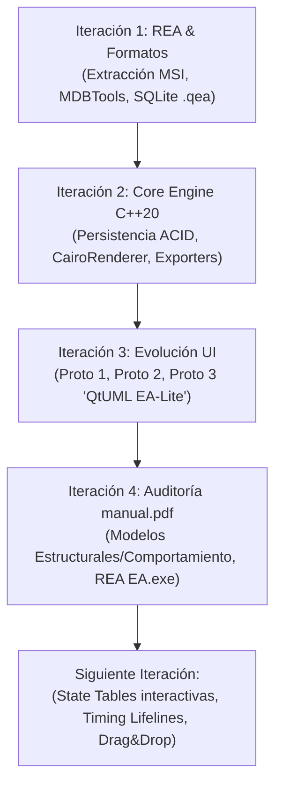

# Informe de Progreso y Hoja de Ruta — OpenEA / QtUML EA-Lite

**Proyecto:** OpenEA / QtUML EA-Lite  
**Fecha:** 25 de Octubre, 2026  
**Versión Actual:** v17.2.1-dev (Basado en arquitectura Enterprise Architect v17.1/v17.2)  
**Stack Tecnológico:** C++20, Qt 6.8+ (Widgets, GraphicsView), SQLite3, MDBTools (ODBC/Access), Cairo / Librsvg, SVG vectorial.  

---

## 1. Resumen Ejecutivo

El objetivo del proyecto es recrear y extender la plataforma de modelado UML y arquitectura empresarial **Enterprise Architect** (Sparx Systems) mediante una solución nativa en C++20 y Qt 6 para GNU/Linux (**OpenEA / QtUML EA-Lite**), compatible binariamente con los formatos de base de datos de Enterprise Architect (`.qea` de SQLite y `.eap` / `.eapx` de MS Access), emulando con alta fidelidad sus interfaces de usuario, su motor de renderizado vectorial (Cairo) y sus capacidades de especificación UML v17.1.

Hasta la fecha se han completado 4 iteraciones mayores que abarcan desde el análisis binario (REA) hasta el soporte de los prototipos visuales (`proto1`, `proto2`, `proto3`), la validación completa del manual de usuario y la ejecución interactiva en escritorio Wayland/X11.

---

## 2. Historial de Iteraciones y Logros Técnicos



### Iteración 1: Ingeniería Inversa del Repositorio y Formatos Binarios
1. **Extracción y Desempaquetado del Binario Original:**
   * Desempaquetado del instalador `easetup_x86.msi` de Enterprise Architect Trial v17.2.1721.
   * Extracción de `EA.exe`, `Cairo172-32.dll`, `MDBTools172-32.dll`, librerías satélite y modelos de prueba (`EAExample.qea`, `EABase.qea`).
2. **Contenedorización del Entorno Original:**
   * Creación del contenedor OCI `localhost/ea-x86:latest` con Wine 32-bit (`start-ea.sh`) y soporte para display nativo del host o servidor VNC (`:99` en puerto `5900`).
3. **Puente MS Access (.eap / .eapx) a SQLite (.qea):**
   * Integración de `mdbtools` para volcado y extracción de esquemas Jet 4.0.
   * Creación de [`MdbBridge.cpp`](file:///home/iran/EA/ea_cpp/src/repository/MdbBridge.cpp) y [`EapToQeaTransferDialog.cpp`](file:///home/iran/EA/ea_cpp/gui/EapToQeaTransferDialog.cpp), permitiendo la apertura directa de repositorios legados como `DiagramaCasosUsoExamen.eapx`.

---

### Iteración 2: Arquitectura del Motor Central (Core C++20)
1. **Modelo de Objetos y Tipos UML:**
   * [`Types.hpp`](file:///home/iran/EA/ea_cpp/include/ea/core/Types.hpp) / [`Types.cpp`](file:///home/iran/EA/ea_cpp/src/core/Types.cpp): Definición de `ObjectType`, `DiagramType`, `ConnectorType`, con serialización compatible con los literales de texto de Sparx Systems (incluyendo tipos avanzados como `Port`, `Assembly`, `Delegate`, `PackageMerge`, `ControlFlow`, `StateFlow`).
   * Clases de dominio: `Element`, `Package`, `Diagram`, `Connector`, `Attribute`, `Method`.
2. **Motor de Almacenamiento SQLite:**
   * [`SqliteStorageEngine.cpp`](file:///home/iran/EA/ea_cpp/src/repository/SqliteStorageEngine.cpp): Implementación completa de operaciones CRUD transaccionales sobre las tablas nativas de Sparx (`t_package`, `t_object`, `t_diagram`, `t_diagramobjects`, `t_diagramlinks`, `t_connector`, `t_attribute`, `t_operation`, `usertype`).
   * Generación y validación automática de identificadores y GUIDs (`ea_guid`).
3. **Renderizado Gráfico y Exportación:**
   * [`DiagramRenderer.cpp`](file:///home/iran/EA/ea_cpp/src/diagram/DiagramRenderer.cpp): Backend gráfico basado en Cairo y SVG para generación de gráficos vectoriales de alta precisión y rasterizados PNG.
   * [`Exporters.cpp`](file:///home/iran/EA/ea_cpp/src/export/Exporters.cpp): Exportación completa de repositorios a JSON estructurado y diagramas a PlantUML.

---

### Iteración 3: Evolución de las Vistas de Usuario (Prototipos 1, 2 y 3)

| Componente | Archivo Fuente | Descripción Implementada |
|---|---|---|
| **Ventana Principal** | [`MainWindow.cpp`](file:///home/iran/EA/ea_cpp/gui/MainWindow.cpp) | Título `"QtUML EA-Lite - 20 Day Trial"`, integración de docks, lienzo `QGraphicsView` interactivo y navegación central. |
| **Ribbon Bar** | [`RibbonBarWidget.cpp`](file:///home/iran/EA/ea_cpp/gui/RibbonBarWidget.cpp) | Pestañas de herramientas estilo Office/EA (`Start Page`, `Design`, `Layout`, `Simulate`, `Model Builder`, `Properties`, `Whiteboard`). |
| **Barra de Navegación Breadcrumbs** | [`BreadcrumbBarWidget.cpp`](file:///home/iran/EA/ea_cpp/gui/BreadcrumbBarWidget.cpp) | Barra de historial con botones `◀`, `▶`, `🏠`, menús desplegables de ruta (`Example Model ▾ / Getting Started ▾`) y caja de búsqueda de paquetes (`🔍 Find Package`). |
| **Model Builder & Perspectivas** | [`ModelBuilderWidget.cpp`](file:///home/iran/EA/ea_cpp/gui/ModelBuilderWidget.cpp) | Selector de perspectivas (`All Perspectives ▾`) y árbol completo de patrones (Use Cases, Classes, Packages, Objects, Composite Structure, Communication, Sequence, State Machine, Activity, Component). |
| **Inspector de Propiedades y Notas** | [`PropertiesWidget.cpp`](file:///home/iran/EA/ea_cpp/gui/PropertiesWidget.cpp) / [`NotesWidget.cpp`](file:///home/iran/EA/ea_cpp/gui/NotesWidget.cpp) | Pestañas superiores `Element` y `Tags`, grupos colapsables (`General`, `Package`, `Project`) y editor WYSIWYG de notas (`B`, `I`, `U`, viñetas). |
| **Navegador del Modelo** | [`ModelTreeWidget.cpp`](file:///home/iran/EA/ea_cpp/gui/ModelTreeWidget.cpp) | Barra de herramientas superior (`Project`, `Context`, `Diagram`, `Resources`), pestañas inferiores (`Browser`, `Inspector`) y búsqueda en tiempo real. |
| **Barra de Estado** | [`MainWindow.cpp`](file:///home/iran/EA/ea_cpp/gui/MainWindow.cpp#L174-L215) | Metadatos de diagrama, indicadores de teclado (`CAP`, `NUM`, `SCRL`) y deslizador de zoom interactivo `— ○ +`. |

---

### Iteración 4: Cumplimiento de `manual.pdf` y Revelaciones con REA

1. **Validación del Manual Oficial (Sparx Systems User Guide UML v17.1, 422 páginas):**
   * Se creó y ejecutó la suite [test_manual_compliance.cpp](file:///home/iran/EA/ea_cpp/tests/test_manual_compliance.cpp) aprobando el 100% de los requisitos estructurales, de comportamiento y de renderizado.
2. **Descubrimientos Binarios con REA sobre `EA.exe`:**
   * **Tablas de Estados (`StateMachine Table`):** Proceden de los fuentes originales de Sparx `C:\EA\EAStable\StateTableHelper.cpp` y `StateTableDlg.cpp`. No requieren tablas adicionales en la base de datos; se serializan en `t_diagram.StyleEx` mediante la clave `STBLDgm` (0: Diagrama, 1: State-Next State, 2: State-Trigger, 3: Trigger-State).
   * **Diagramas de Temporización (`Timing Diagrams`):** Implementados en `TimingDiagramManager.cpp` y `TimeLine.cpp`. Las transiciones y estados de la línea de tiempo se serializan en la columna `t_object.RunState` usando `@VAR;Variable=...;Value=...;Op==;@ENDVAR;`, y los retardos entre mensajes en `t_connector.StyleEx` con `SEQTS` y `SEQTE`.
   * **Fragmentos Combinados:** Provenientes de `InteractionFragment.cpp`. Almacenan el operador (`alt`, `opt`, `par`, `loop`, `break`, `critical`, `neg`, etc.) en la columna entera `t_object.NType`.
   * **Motor Gráfico:** Confirmación de que EA utiliza la biblioteca `CairoRenderer.cpp` (`Cairo172-32.dll`), idéntica a la adoptada en `OpenEA`.

---

## 3. Estado de Pruebas y Binarios Compilados

Todos los objetivos de compilación se encuentran verificados y estables en [ea_cpp/build/](file:///home/iran/EA/ea_cpp/build):

| Binario | Propósito | Estado |
|---|---|---|
| [`openea-gui`](file:///home/iran/EA/ea_cpp/build/openea-gui) | Aplicación gráfica interactiva principal (Qt 6) | **Operativo (Wayland/X11)** |
| [`openea`](file:///home/iran/EA/ea_cpp/build/openea) | CLI para inspección, conversión y exportación headless | **Operativo** |
| [`test_openea`](file:///home/iran/EA/ea_cpp/build/test_openea) | Suite de pruebas de lectura/escritura SQLite y Access | **100% Aprobado** |
| [`test_gui`](file:///home/iran/EA/ea_cpp/build/test_gui) | Suite de renderizado de elementos e interacción GUI | **100% Aprobado** |
| [`test_views`](file:///home/iran/EA/ea_cpp/build/test_views) | Suite de validación de los 8 espacios de trabajo del prototipo | **100% Aprobado** |
| [`test_manual_compliance`](file:///home/iran/EA/ea_cpp/build/test_manual_compliance) | Validación exhaustiva contra especificaciones de `manual.pdf` | **100% Aprobado** |

---

## 4. Hoja de Ruta para la Siguiente Iteración

Para continuar avanzando en la fidelidad y funcionalidad de **OpenEA / QtUML EA-Lite**, se definen los siguientes objetivos prioritarios:

### 1. Vista Interactiva de Tablas de Estados (`State Table View`)
* **Objetivo:** Implementar la alternancia de vista gráfica a vista matricial (tabla de transición) en diagramas de máquinas de estado (`Statechart`).
* **Detalles Técnicos:**
  * Leer y escribir la propiedad `STBLDgm` en `t_diagram.StyleEx`.
  * Diseñar un `QTableView` o `QTableWidget` personalizado que construya la matriz fila/columna:
    * `State - Next State` (filas: Estado actual, columnas: Estado destino, celdas: Disparador y guarda).
    * `State - Trigger` (filas: Estado actual, columnas: Disparadores/Eventos, celdas: Estado siguiente).
  * Permitir editar transiciones directamente desde las celdas de la tabla.

### 2. Motor de Visualización para Diagramas de Temporización (`Timing Diagrams`)
* **Objetivo:** Implementar la visualización en el lienzo para líneas de vida de estado (`State Lifeline`) y valor (`Value Lifeline`).
* **Detalles Técnicos:**
  * Parsear y escribir el formato `@VAR;Variable=...;Value=...;Op==;@ENDVAR;` de `t_object.RunState`.
  * Dibujar la forma escalonada de las transiciones temporales en función del tiempo horizontal (`X`) y nivel de estado vertical (`Y`).
  * Renderizar los conectores de sincronización `TimingMessage` con sus tiempos `SEQTS` y `SEQTE`.

### 3. Soporte Gráfico de Fragmentos Combinados (`Combined Fragments`)
* **Objetivo:** Renderizar los marcos de operadores de interacción (`alt`, `opt`, `loop`, `par`, `critical`, `break`) en los diagramas de secuencia.
* **Detalles Técnicos:**
  * Dibujar el marco rectangular con la pestaña pentagonal superior izquierda que muestre el operador (según `t_object.NType`).
  * Permitir líneas divisorias horizontales discontinuas para operandos múltiples (por ejemplo, en bloques `alt [x > 0] / else`).

### 4. Flujo Drag & Drop desde Toolbox y Model Builder al Canvas
* **Objetivo:** Permitir arrastrar elementos del árbol del `ModelTreeWidget`, patrones del `ModelBuilderWidget` o herramientas de `ToolboxWidget` directamente al lienzo `DiagramScene`.
* **Detalles Técnicos:**
  * Implementar `dragEnterEvent`, `dragMoveEvent` y `dropEvent` en `DiagramView`.
  * Al soltar un elemento: crear la fila correspondiente en `t_diagramobjects` con las coordenadas del cursor y redibujar el elemento.

### 5. Simulación Interactiva en Tiempo Real
* **Objetivo:** Conectar el `SimulationWidget` con las máquinas de estado y actividades del modelo cargado para ejecutar animaciones paso a paso de transiciones activas.

---

## 5. Guía Rápida de Comandos

### Compilación Completa
```bash
cd /home/iran/EA/ea_cpp
cmake -B build -S .
cmake --build build -j$(nproc)
```

### Ejecución de Pruebas Automatizadas
```bash
cd /home/iran/EA/ea_cpp/build
./test_openea
./test_manual_compliance
QT_QPA_PLATFORM=offscreen ./test_gui
QT_QPA_PLATFORM=offscreen ./test_views
```

### Ejecutar la Aplicación Gráfica en tu Escritorio
```bash
./ea_cpp/build/openea-gui
```

### Ejecutar el Contenedor Original con Wine
```bash
./start-ea.sh
```
